<picture>
  <source media="(prefers-color-scheme: dark)" srcset="assets/header-dark.svg">
  
</picture>

  
  
  

## About me

I build LLM applications that have to be right, not just fluent: retrieval that cites its sources, agents that ask before they act, and evaluations that measure how often the answer is correct. I spent two years in test automation before moving into AI, so my main projects ship with CI and a test suite.

- 🔭 **Now:** building [Maintenance Copilot](https://github.com/baddy1411/maintenance-copilot), cited Q&A and an approval-gated agent over live FAA maintenance data
- 🎓 **M.Sc. Computer Science, Data Engineering**, Constructor University Bremen (grade 1.72). Thesis: quantum vs classical reservoir computing for chaotic time-series forecasting
- 💼 **Before:** RAG engineering at Oakter (New Delhi) and test automation at Capgemini (Pune)
- 📜 AWS Certified Data Engineer – Associate · DataCamp AI Engineer Associate
- 🗣️ English (C1) · German (B1, learning)

## Results I can point to

<table>
  <tr>
    <td align="center" valign="top" width="50%"><h3>76% → 82%</h3>retrieval hit rate after adding reranking to an Azure OpenAI RAG assistant</td>
    <td align="center" valign="top" width="50%"><h3>~10s → 6s</h3>response time on the same assistant, traced with OpenTelemetry and Grafana</td>
  </tr>
  <tr>
    <td align="center" valign="top" width="50%"><h3>~50%</h3>lower error forecasting hot-metal silicon from 188,700 rows of sensor data (SMS group project)</td>
    <td align="center" valign="top" width="50%"><h3>213 / 214</h3>thesis comparisons where a classical model beat the quantum one</td>
  </tr>
</table>

## Featured projects

<table>
  <tr>
    <td width="50%" valign="top">
      <h3>🛠️ <a href="https://github.com/baddy1411/maintenance-copilot">Maintenance Copilot</a></h3>
      Cited Q&amp;A and an approval-gated troubleshooting agent over FAA Airworthiness Directives, Service Difficulty Reports and AMT handbooks. Work in progress, documented phase by phase.  
      <code>LangGraph</code> <code>Postgres + pgvector</code> <code>FastAPI</code> <code>RAG</code> <code>Python</code>
    </td>
    <td width="50%" valign="top">
      <h3>🧹 <a href="https://meldify.130-61-142-164.sslip.io">Meldify</a> live</h3>
      AI data-cleaning platform that matches CRM and billing records, shows where each field mapping came from, and previews every change before applying it. Ships an MCP server so coding agents can use its tools.  
      <code>React</code> <code>TypeScript</code> <code>FastAPI</code> <code>PostgreSQL</code> <code>MCP</code>
    </td>
  </tr>
  <tr>
    <td width="50%" valign="top">
      <h3>🌀 <a href="https://github.com/baddy1411/qde-benchmark">Quantum vs Classical Reservoir Computing</a></h3>
      My M.Sc. thesis artifact. Classical models won all 26 matched comparisons on chaotic time series. 131 tests, 8 fault-injection gates, and <code>make verify</code> reproduces the checks in about two minutes.  
      <code>Python</code> <code>Time series</code> <code>Reproducibility</code> <code>Docker</code>
    </td>
    <td width="50%" valign="top">
      <h3>🏭 <a href="https://github.com/baddy1411/sensorops">SensorOps</a></h3>
      Predictive maintenance with three benchmarked anomaly detectors, a RAG copilot that writes incident reports, and a hash-chained audit log for every prediction. 93 tests.  
      <code>PyTorch</code> <code>Dagster</code> <code>MLflow</code> <code>ChromaDB</code> <code>FastAPI</code>
    </td>
  </tr>
  <tr>
    <td width="50%" valign="top">
      <h3>📚 <a href="https://github.com/baddy1411/compliance-assistant">Compliance Assistant</a></h3>
      RAG over regulatory documents (GDPR, EU AI Act) that answers with citations and says "I don't know" when the documents don't cover the question. Includes evals and a LoRA fine-tuning path.  
      <code>RAG</code> <code>ChromaDB</code> <code>sentence-transformers</code> <code>LoRA</code> <code>FastAPI</code>
    </td>
    <td width="50%" valign="top">
      <h3>🧊 <a href="https://github.com/baddy1411/real-time-medallion-lakehouse">Real-Time Medallion Lakehouse</a></h3>
      Streaming platform from raw events to a star schema: Kafka into Spark Structured Streaming, Iceberg tables with a quarantine for bad rows, Polars microbatches, and dbt + DuckDB for the gold layer, all on Kubernetes.  
      <code>Kafka</code> <code>Spark</code> <code>Iceberg</code> <code>Polars</code> <code>dbt</code> <code>Kubernetes</code>
    </td>
  </tr>
</table>

More data engineering: <a href="https://github.com/baddy1411/nyc-taxi-lakehouse">nyc-taxi-lakehouse</a> · <a href="https://github.com/baddy1411/carbon-intelligence-platform">carbon-intelligence-platform</a>

## Tech stack

  <picture>
    <source media="(prefers-color-scheme: dark)" srcset="https://skillicons.dev/icons?i=py%2Cc%2Ccpp%2Cbash%2Cts%2Creact%2Cfastapi%2Cpytorch%2Ctensorflow%2Csklearn&theme=dark">
    
  </picture>
   
  <picture>
    <source media="(prefers-color-scheme: dark)" srcset="https://skillicons.dev/icons?i=postgres%2Cmysql%2Cmongodb%2Credis%2Ckafka%2Caws%2Cazure%2Cdocker%2Ckubernetes%2Cgithubactions%2Cgrafana%2Cprometheus&theme=dark">
    
  </picture>

  
  
  
  
  
  
  
  
  
  
  
  
  

Based in Bremen, Germany · open to conversations about AI engineering roles

