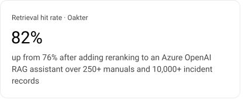
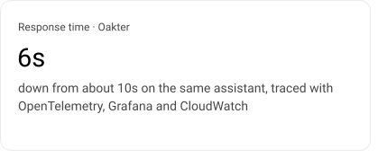
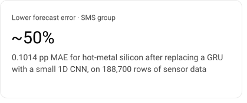
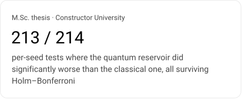
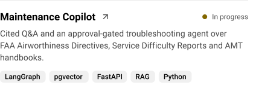
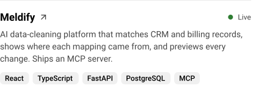
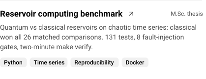
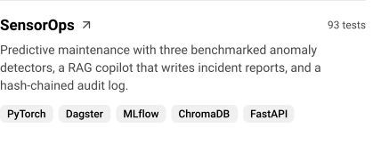
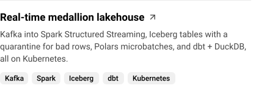
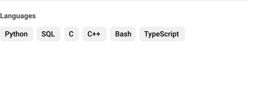

<picture><source media="(prefers-color-scheme: dark)" srcset="assets/header-dark.svg"></picture>

<a href="https://www.linkedin.com/in/badrishms"><picture><source media="(prefers-color-scheme: dark)" srcset="assets/button-linkedin-dark.svg"></picture></a>
<a href="https://meldify.130-61-142-164.sslip.io"><picture><source media="(prefers-color-scheme: dark)" srcset="assets/button-meldify-dark.svg"></picture></a>

## About me

I build LLM applications that have to be right, not just fluent: retrieval that cites its sources, agents that ask before they act, and evaluations that measure how often the answer is correct. I spent two years in test automation before moving into AI, so my main projects ship with CI and a test suite.

- **Now:** building [Maintenance Copilot](https://github.com/baddy1411/maintenance-copilot), cited Q&A and an approval-gated agent over live FAA maintenance data
- **Education:** M.Sc. Computer Science, Data Engineering, Constructor University Bremen (grade 1.72), with a thesis on quantum vs classical reservoir computing for chaotic time-series forecasting
- **Before:** RAG engineering at Oakter (New Delhi) and test automation at Capgemini (Pune)
- **Certified:** AWS Certified Data Engineer – Associate · DataCamp AI Engineer Associate
- **Languages:** English (C1) · German (B1, learning)

## Results I can point to

<picture><source media="(prefers-color-scheme: dark)" srcset="assets/metric-1-dark.svg"></picture>
<picture><source media="(prefers-color-scheme: dark)" srcset="assets/metric-2-dark.svg"></picture>
<picture><source media="(prefers-color-scheme: dark)" srcset="assets/metric-3-dark.svg"></picture>
<picture><source media="(prefers-color-scheme: dark)" srcset="assets/metric-4-dark.svg"></picture>

## Featured projects

<a href="https://github.com/baddy1411/maintenance-copilot"><picture><source media="(prefers-color-scheme: dark)" srcset="assets/project-maintenance-copilot-dark.svg"></picture></a>
<a href="https://meldify.130-61-142-164.sslip.io"><picture><source media="(prefers-color-scheme: dark)" srcset="assets/project-meldify-dark.svg"></picture></a>
<a href="https://github.com/baddy1411/qde-benchmark"><picture><source media="(prefers-color-scheme: dark)" srcset="assets/project-qde-benchmark-dark.svg"></picture></a>
<a href="https://github.com/baddy1411/sensorops"><picture><source media="(prefers-color-scheme: dark)" srcset="assets/project-sensorops-dark.svg"></picture></a>
<a href="https://github.com/baddy1411/compliance-assistant"><picture><source media="(prefers-color-scheme: dark)" srcset="assets/project-compliance-assistant-dark.svg"></picture></a>
<a href="https://github.com/baddy1411/real-time-medallion-lakehouse"><picture><source media="(prefers-color-scheme: dark)" srcset="assets/project-medallion-lakehouse-dark.svg"></picture></a>

More data engineering: <a href="https://github.com/baddy1411/nyc-taxi-lakehouse">nyc-taxi-lakehouse</a> · <a href="https://github.com/baddy1411/carbon-intelligence-platform">carbon-intelligence-platform</a>

## Tech stack

<picture><source media="(prefers-color-scheme: dark)" srcset="assets/stack-languages-dark.svg"></picture>
<picture><source media="(prefers-color-scheme: dark)" srcset="assets/stack-ai-dark.svg"></picture>
<picture><source media="(prefers-color-scheme: dark)" srcset="assets/stack-ml-dark.svg"></picture>
<picture><source media="(prefers-color-scheme: dark)" srcset="assets/stack-providers-dark.svg"></picture>
<picture><source media="(prefers-color-scheme: dark)" srcset="assets/stack-data-dark.svg"></picture>
<picture><source media="(prefers-color-scheme: dark)" srcset="assets/stack-cloud-dark.svg"></picture>

Built with the <a href="https://github.com/meta/astryx">Astryx</a> neutral theme. Assets are generated by <code>npm run build</code>.
